👋 Olá! Sou o **Gleisson Trindade**, developer de `SQL` e `ERP` a fazer a transição para **Ciência de Dados**.

📍 **Onde:** Lisboa, Portugal  
🎓 **Formação:** Licenciatura em Ciência de Dados no [**ISCTE**](https://www.iscte-iul.pt/)  
💼 **Experiência:** ERP & E-commerce Developer — SQL Server, PHC, Python e integrações com marketplaces  
💻 **Interesses:** Bases de dados, análise de dados, automação e `Machine Learning`  
🥋 **Hobbies:** Capoeira, airsoft e dança

## 🛠️ Tech Stack

## 📚 Projetos da faculdade

| Unidade curricular | Projeto | Tecnologias | Estado |
|---|---|---|---|
| Tópicos de Matemática I | [Estudo de funções e métodos numéricos](https://github.com/gleissontrindade-dotcom/topicos-matematica-1) | Python, NumPy, Matplotlib | ✅ Concluído |
| Programação | Projeto individual | Python | 🚧 Entrega a 30 nov 2026 |
| Análise Exploratória de Dados | Trabalho de grupo, com apresentação | R, Excel | 🚧 Apresentação a 14 dez 2026 |
| Tópicos de Matemática I | 2.º trabalho: derivação, integração numérica e EDO | Python, NumPy | 🗓️ Previsto (dez 2026) |

## 📊 Estatísticas GitHub

## 🌐 Contacto

## 👻 Contribuições

